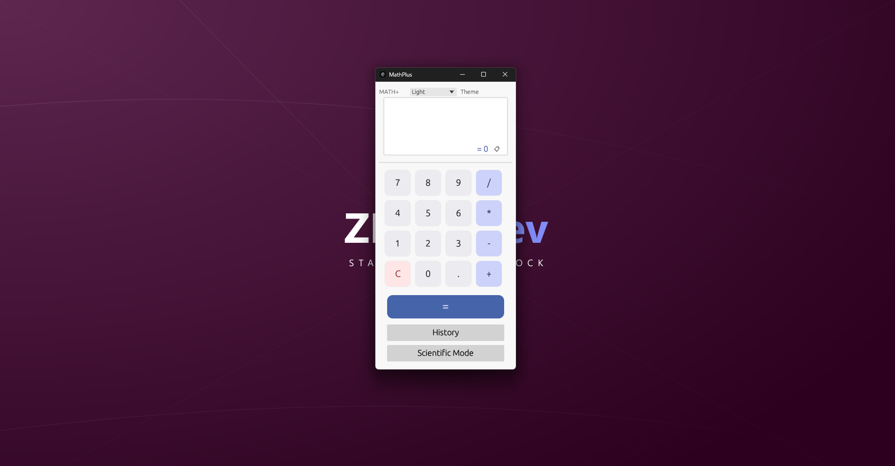
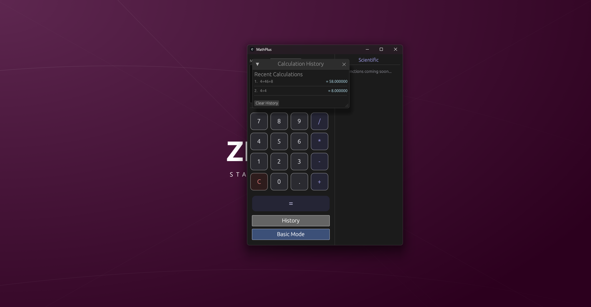

[](https://github.com/ZFordDev/MathPlus/releases)


# MathPlus

A tiny, fast calculator for Windows, Linux, and macOS, built in Rust with [egui](https://github.com/emilk/egui).

No telemetry. No background processes. It opens instantly and stays out of your way.

<p align="center">
  
  
</p>

## Features

- Standard arithmetic, plus a toggleable scientific panel
- Chained left-to-right evaluation by default, with standard precedence available
- Calculation history (press `H`)
- Light, dark, and system themes
- Keyboard-first input
- Copy result to clipboard
- Small codebase — good for learning `egui`/`eframe`

## Install

**Windows:** grab the installer or portable `.exe` from the [releases page](https://github.com/ZFordDev/MathPlus/releases/latest). The installer puts MathPlus in `C:\Program Files\ZFordDev\MathPlus` and adds a Start Menu shortcut. A clean uninstall is included.

**Linux / macOS:** download the executable for your platform from the [releases page](https://github.com/ZFordDev/MathPlus/releases/latest).

## Build from source

Requires Rust 1.85+.

```bash
git clone https://github.com/ZFordDev/MathPlus.git
cd MathPlus
cargo build --release
```

The binary lands in `target/release/` (`MathPlus.exe` on Windows).

## Shortcuts

| Key | Action |
|---|---|
| `0–9` `.` `+` `-` `*` `/` | Type an expression |
| `Enter` or `=` | Evaluate |
| `Backspace` | Delete previous character |
| `Esc` or `C` | Clear |
| `Ctrl+C` | Copy result |
| `H` | Open history |

The expression field is editable — click anywhere in it to fix a typo mid-expression.

Use the **Mode** selector to switch between **Chained** evaluation (left to right)
and **Standard** evaluation (operator precedence). Scientific mode always uses
standard precedence.

## Project layout

```text
src/
├── main.rs        # Entry point
├── app.rs         # App state and update loop
├── logic.rs       # Expression handling
├── history.rs     # Calculation history
├── history_ui.rs  # History window
├── shortcuts.rs   # Keyboard input
├── theme.rs       # Light/dark/system themes
└── ui/            # UI panels (display, keypad, scientific, layout)
```

## Contributing

Bug reports, ideas, and PRs are welcome - see [CONTRIBUTING.md](CONTRIBUTING.md).

## Security

Report vulnerabilities privately via [GitHub security advisories](https://github.com/ZFordDev/MathPlus/security/advisories/new). See [SECURITY.md](SECURITY.md).

## License

MIT - see [LICENCE](LICENCE).

---

Made by [ZFordDev](https://github.com/ZFordDev). Also check out [SchedPlus](https://github.com/ZFordDev/SchedPlus), a lightweight desktop scheduler.
